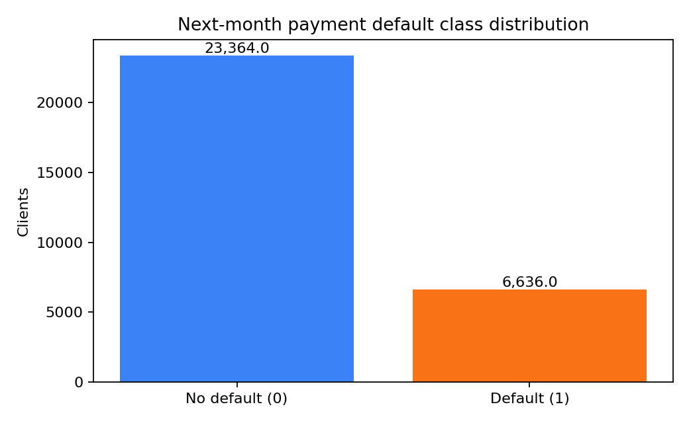
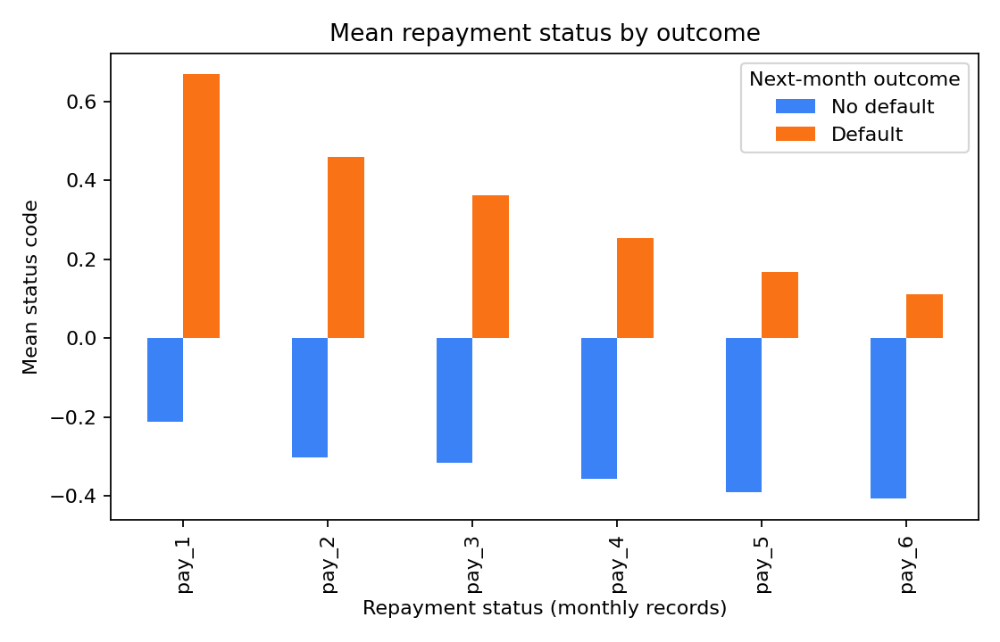

# CreditLens | Credit-card default analytics

CreditLens is a portfolio project for exploring historical credit-card repayment behavior, comparing baseline classification pipelines, and explaining their outputs. It is an educational analysis of **next-month credit-card default**; it does not predict loan approval or recommend credit decisions.

## Problem statement

Given historical customer, repayment-status, bill-statement, and payment-amount fields, can simple models distinguish clients who did and did not default on a credit-card payment in the following month? The project demonstrates an end-to-end analytics workflow and makes its evaluation and limitations visible.

## Dataset and attribution

The project uses the supplied [UCI Default of Credit Card Clients dataset](https://archive.ics.uci.edu/dataset/350/defaultofcreditcardclients), donated by I-Cheng Yeh. It contains 30,000 Taiwan credit-card client records and 23 explanatory fields; the target is `default payment next month` (1 = default, 0 = no default). The included workbook is `data/default of credit card clients.xls`.

**Attribution:** Yeh, I. (2009). *Default of Credit Card Clients* [Dataset]. UCI Machine Learning Repository. [https://doi.org/10.24432/C55S3H](https://doi.org/10.24432/C55S3H). Dataset license: [CC BY 4.0](https://creativecommons.org/licenses/by/4.0/). The workbook is retained in the repository with this attribution.

## Features

- Executive overview with observed class share and default rate.
- Interactive descriptive charts filtered by age, sex, education, and marital-status codes.
- Logistic Regression and Random Forest comparison.
- Probability estimate for a selected held-out test record.
- Global and per-record Tree SHAP explanations for Random Forest.
- Held-out metrics, confusion matrix, ROC, precision–recall, and calibration charts.
- Limitations and responsible-use guidance.

## Methodology

- The cleaner uses sheet `Data`, takes worksheet row 2 as the field-name row, normalizes names, renames `PAY_0` to `pay_1`, and removes exact duplicates or rows with an unusable target. The source workbook remains unchanged.
- An 80/20 stratified train/test split uses random seed 42. `id` and the target are excluded from predictors.
- Scikit-learn pipelines fit median imputation for numeric fields, most-frequent imputation and one-hot encoding for coded categories, and numeric scaling for Logistic Regression. These transformations are fitted on training data only.
- Logistic Regression and Random Forest use class weighting. Metrics are calculated from genuine predictions/probabilities on the held-out test partition; threshold-based metrics use 0.50.
- SHAP values describe model contributions under Tree SHAP's path-dependent explanation. They are not causal effects.

## Findings and held-out evaluation

The workbook contains **30,000** records: **23,364 (77.88%)** are class 0 and **6,636 (22.12%)** are class 1. The held-out test partition contains 6,000 records, with a 22.12% default share.

Results below were reproduced with seed 42 and the pipelines in `src/modeling.py`. They are single-split estimates, not guarantees of future performance.

| Model | Accuracy | Precision | Recall | F1 | Specificity | ROC AUC | Average precision | Brier ↓ |
|---|---:|---:|---:|---:|---:|---:|---:|---:|
| Logistic Regression | 0.7735 | 0.4893 | 0.5531 | 0.5193 | 0.8361 | 0.7588 | 0.5241 | 0.1865 |
| Random Forest | 0.7968 | 0.5412 | 0.5350 | 0.5381 | 0.8712 | 0.7747 | 0.5522 | 0.1580 |

At the illustrative 0.50 threshold, Logistic Regression has slightly higher default recall, while Random Forest has higher ROC AUC and average precision and lower Brier score on this split. Confusion matrices (rows = actual 0/1; columns = predicted 0/1): Logistic Regression `[[3907, 766], [593, 734]]`; Random Forest `[[4071, 602], [617, 710]]`.





## Limitations and responsible use

- These are Taiwan credit-card repayment records from 2005. They may not generalize across time, regions, populations, products, or jurisdictions.
- A random stratified holdout is not temporal or external validation. There is no fairness assessment, calibration intervention, monitoring, or deployment review.
- Class weighting and a 0.50 threshold do not encode business costs. Precision and recall trade off; reported scores are not a decision policy.
- SHAP is an explanation of model behavior, not causal evidence or a complete account of an individual's circumstances.
- Do not use this portfolio app to make or automate decisions about real people. Any consequential use would require suitable data, legal/compliance review, validation, fairness analysis, and ongoing monitoring.

## Setup and local run

Use Python 3.11 to match the locally verified environment. From the repository root:

```powershell
python -m venv .venv
.\.venv\Scripts\Activate.ps1
python -m pip install -r requirements.txt
```

Run CreditLens:

```powershell
python -m streamlit run app.py
```

Streamlit prints the local URL. The app reads the cleaned CSV at `data/processed/credit_default_clean.csv` when present; otherwise it loads and cleans the included workbook. Both paths are inside this repository—no files outside the checkout are required.

Run checks with:

```powershell
python -m pytest -q
```

## Project layout

```text
app.py             Streamlit application
src/clean_data.py  reusable workbook cleaning pipeline
src/modeling.py    split, preprocessing, models, held-out evaluation
data/              attributed source workbook and generated processed CSV
reports/           data dictionary, EDA report, and figures
tests/             cleaning, preprocessing, and evaluation tests
```
